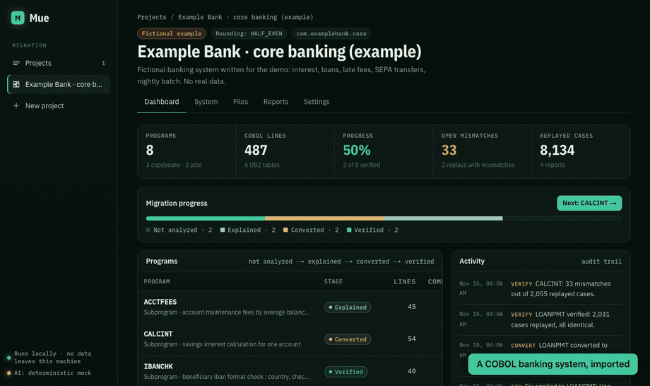

# Mue

**Donnez-lui votre COBOL. Il l'explique, le réécrit en Java, et prouve que les deux donnent les mêmes résultats sur des milliers d'opérations.**

<p align="center"></p>

Mue est une boîte à outils open source (AGPL-3.0) pour migrer du COBOL vers Java avec des preuves :

1. **Comprendre** : analyse des programmes, copies et JCL, carte du système, règles métier avec leur ligne d'origine.
2. **Convertir** : Java lisible (`BigDecimal`, noms métier, une méthode par paragraphe, correspondance des lignes).
3. **Vérifier** : les mêmes cas (générés, cas limites, demi-centimes ciblés, ou vos propres données enregistrées) passent dans un interpréteur COBOL de référence et dans le Java ; chaque écart est remonté jusqu'à l'instruction fautive.

Tout tourne en local, sans clé ni appel réseau.

## Démarrage

```bash
git clone https://github.com/tbsrgt/mue.git && cd mue
npm ci
npm run mue -- verify examples/banking --rounding HALF_EVEN
```

La troisième commande sort avec le code 1 : elle trouve des écarts, c'est voulu. Sans `--rounding HALF_EVEN`, tous les programmes convertis passent. Node.js 22.13 ou plus récent. Interface web locale : `npm run studio` (http://localhost:3000).

## L'exemple CALCINT

Avec la convention Java `HALF_EVEN`, le calcul d'intérêts `CALCINT` donne **38 écarts sur 2 400 cas**, tous à la ligne 46 : le `ROUNDED` du COBOL arrondit le demi-centime vers le haut (`275,005` → `275,01`), `HALF_EVEN` vers le chiffre pair (`275,00`). Les 2 340 cas aléatoires n'en trouvent aucun : ce sont les cas ciblés sur les demi-centimes qui les révèlent. Après la correction (`--fix CALCINT=HALF_UP`) : **2 400 / 2 400 identiques**. Ces chiffres viennent de `--cases 2400` ; par défaut, Mue (et le Studio) rejoue 2 055 cas pour CALCINT, dont 33 diffèrent en `HALF_EVEN`.

Ce n'est pas une preuve formelle mais du test différentiel reproductible (graine déterministe). Limites actuelles : le COBOL est exécuté par l'interpréteur de Mue (modèle IBM `ARITH(EXTEND)`), pas encore recoupé avec un vrai compilateur ; `verify` exécute le Java par un modèle `BigDecimal` de la même représentation intermédiaire, pas sur une JVM. La CI compile le Java généré de l'exemple avec `javac` (JDK 21) et rejoue tous les cas de CALCINT sur les classes compilées ; les autres programmes sont compilés, pas encore exécutés. Seul le sous-ensemble COBOL listé est pris en charge, le reste est signalé et écarté.

Le sous-ensemble COBOL pris en charge, l'architecture, la feuille de route et le comparatif sont détaillés dans le [README anglais](README.md).

## Licence

[AGPL-3.0-only](LICENSE). Une licence commerciale est possible : contactez le mainteneur en privé via GitHub ([github.com/tbsrgt](https://github.com/tbsrgt)).
