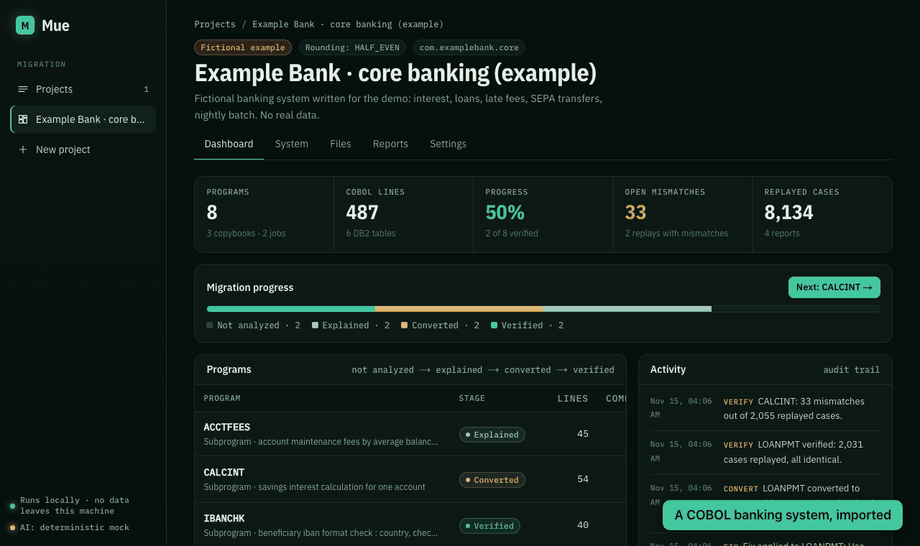

<p align="center"></p>

<h1 align="center">Mue</h1>

<p align="center"><b>Give it your COBOL. It explains it, rewrites it in Java, and proves both produce identical results on thousands of transactions.</b></p>

<p align="center">
  <a href="LICENSE"></a>
  
  
</p>

<p align="center"></p>

Getting Java out of COBOL is only half of a mainframe migration. The hard part is being able to say, with evidence, that the new code computes **exactly** the same cents as the old one. Mue is an open-source toolkit built around that question:

1. **Understand**: parse the programs, copybooks and JCL, map the system (calls, tables, dead code) and write down each business rule with its source line.
2. **Convert**: emit readable Java (`BigDecimal`, business names, one method per paragraph, COBOL line ↔ Java line mapping).
3. **Verify**: replay the same generated and recorded cases through a COBOL reference interpreter and through the Java, compare every output field, SQL write, external call and `DISPLAY` line, and trace every mismatch back to the statement that caused it.

Everything runs locally. No model, key or network call is required.

## Quick start

```bash
git clone https://github.com/tbsrgt/mue.git && cd mue
npm ci
npm run mue -- verify examples/banking --rounding HALF_EVEN
```

The third command converts the example banking system with a common Java team convention (banker's rounding) and shows where it changes results; it exits with code 1 because it finds mismatches, which is the point. Drop `--rounding HALF_EVEN` to see every converted program pass. Requires Node.js 22.13 or later. Then open the local web UI with `npm run studio` (http://localhost:3000).

## How the equivalence check works: the CALCINT story

`examples/banking/CALCINT.cbl` computes savings interest, written in 1998:

```cobol
COMPUTE LK-INTEREST ROUNDED =
   ACCT-BALANCE * ACCT-RATE * LK-DAYS
   / WS-ANNUAL-BASIS
```

Your Java team's coding standard says monetary rounding is `RoundingMode.HALF_EVEN`. The translation looks perfect. Mue replays 2,400 cases through both:

```console
$ npm run mue -- verify examples/banking --program CALCINT --cases 2400 --rounding HALF_EVEN
CALCINT   MISMATCH    2,362 / 2,400  identical  38 different
          └─ Half-cent rounding: CALCINT line 46, LK-INTEREST (e.g. exact 275.005 → COBOL 275.01, Java 275.00)
             fix: --fix CALCINT=HALF_UP
```

**Found.** 38 cases differ, all at line 46, all on field `LK-INTEREST`.

**Explained.** COBOL `ROUNDED` rounds half away from zero; `HALF_EVEN` rounds half to the even digit. They only disagree when a result lands exactly on a half-cent with an even digit before it: `275.005` becomes `275.01` in COBOL and `275.00` in Java. The report lists the exact intermediate value of every failing case.

Note where the 38 come from: the 2,340 realistic random cases found **zero** mismatches. All 38 come from the harness's targeted search for rounding ties. Random testing alone would have signed this migration off.

Without `--cases`, Mue runs 2,000 random cases plus the edge cases, which is 2,055 cases for CALCINT; that is also what the Studio (and the demo above) runs, with 33 mismatches under `HALF_EVEN`. The tie search scales with the number of cases, hence 38 at 2,400.

**Fixed and proven.**

```console
$ npm run mue -- verify examples/banking --program CALCINT --cases 2400 --rounding HALF_EVEN --fix CALCINT=HALF_UP
CALCINT   equivalent  2,400 / 2,400  identical
```

The run writes `mue-report/report.md`, `report.html` (printable, with sign-off lines for an audit file) and `report.json`. The exit code is non-zero whenever a mismatch remains, so the check can gate a CI pipeline.

### What "proof" means here

It is **differential testing**, not formal verification. For each program Mue:

- builds a test plan from the data flow: inputs read before they are written, `SELECT ... INTO` results, cursor rows, outputs;
- generates realistic values from the `PIC` clauses and field names, then edge cases: zeros, negatives, maximum values for every `PIC`, values on both sides of every condition boundary, every level-88 value;
- runs a targeted search for half-cent ties on every `ROUNDED` statement, including inside called subprograms;
- replays your own recorded inputs if you give it some (`--inputs cases.json`);
- runs everything through both engines with a deterministic seed, so every report can be reproduced exactly.

Database access and programs missing from the sources are stubbed identically on both sides; only the converted code is compared. If a program contains a construct Mue does not convert, it is **skipped and reported, never declared equivalent**.

Honest caveats, all on the roadmap:

- The COBOL side is Mue's own interpreter, which models IBM Enterprise COBOL arithmetic (`ARITH(EXTEND)`: 31-digit intermediates, `ROUNDED` half away from zero, silent high-order truncation). It has not yet been cross-checked against a real compiler.
- `verify` executes the Java through a `BigDecimal` model of the same intermediate representation the Java text is rendered from, not on a JVM. CI compiles the emitted Java of the example with `javac` (JDK 21) and replays every CALCINT case through the compiled classes against the COBOL interpreter; the other example programs are compiled but not yet executed on a JVM.
- Only the subset listed below is supported; anything else is flagged and skipped.

## The CLI

```bash
npm run mue -- analyze  <dir> [--format md|json] [--out FILE]
npm run mue -- convert  <dir> [--out java/]
npm run mue -- verify   <dir> [--cases N] [--report-dir DIR] [--inputs FILE] [--strict]
```

Conversion options, for `convert` and `verify`: `--rounding HALF_UP|HALF_EVEN` (default `HALF_UP`, COBOL-exact), `--overflow reproduce|ignore`, `--package com.example.bank`, `--fix PROGRAM=MODE` (repeatable).

- **`analyze`** prints the inventory (lines, cyclomatic complexity, calls, tables, dead paragraphs, constructs needing manual work), the call graph as a Mermaid diagram, and the business rules of every program with their source lines.
- **`convert`** writes one Java class per program, one class per shared copybook, and the small runtime it needs (`Pic`, `Sql`, …) under `java/<package>/`.
- **`verify`** prints one line per program and writes Markdown, HTML and JSON reports. Exit codes: `0` all verified programs are equivalent, `1` mismatches (or skipped programs with `--strict`), `2` usage error, `3` internal error.

Recorded inputs are a JSON object keyed by program:

```json
{ "CALCINT": [{ "inputs": { "ACCT-STATUS": "A", "ACCT-BALANCE": "1234.50", "ACCT-RATE": "1.0000", "LK-DAYS": "365" } }] }
```

After `npm run build`, the same CLI is available as `node dist/cli.js`. The npm package name is `mue-cobol` (not published yet).

## The library

```ts
import { loadSources, analyze, explain, transpile, verify } from "mue-cobol";

const system = analyze(loadSources("examples/banking"));
const rules = await explain(system, "CALCINT");                  // plain-language rules with line numbers
const java = transpile(system, { conventions: { rounding: "HALF_EVEN" } });
const run = await verify(system, { cases: 2400, overrides: { CALCINT: { rounding: "HALF_UP" } } });
console.log(run.totals); // { programs, equivalent, mismatch, skipped, cases, identical, mismatches }
```

## Mue Studio

`npm run studio` starts a local web UI on top of the same core: projects, file import (upload or paste), system map, the Understand → Convert → Verify pipeline per program, side-by-side COBOL/Java with line mapping, one-click fixes, report history and printable reports. Data lives in a local SQLite file (`data/mue.db`, via `node:sqlite`). An example project with the banking system is created on first start; `npm run seed` resets it.

### AI

Explanations come from a deterministic, offline provider built on the parser and the analysis (`lib/ai/mock.ts`). It is the default and needs no key. `lib/ai/llm.ts` documents an optional adapter for a language model (hosted or local); it is not wired and makes no network call. Whatever the provider, the semantics of the Java code always come from the deterministic transpiler, because that is what the harness executes: a model may rephrase explanations and names, never logic.

## Supported COBOL subset

Mue targets the batch business logic found in banking and insurance code. It deliberately supports a bounded subset, and says so when it meets anything else.

**Converted and verified**

- Fixed and free format, comment, continuation and debugging lines; `COPY` (without `REPLACING`); `DECIMAL-POINT IS COMMA`.
- `WORKING-STORAGE` and `LINKAGE SECTION`; levels 01–49 and 77; level-88 conditions (several values, `THRU`); `VALUE`; figurative constants.
- `PIC` with `9`, `S`, `V`, `X`, `A`; `OCCURS` on elementary items with subscripts.
- `USAGE DISPLAY`, `COMP`, `COMP-3` / `PACKED-DECIMAL`, `COMP-5`, `BINARY`, modeled at the value level (digits, scale, sign), not as byte layouts.
- `MOVE` (including group to group with the same structure), `COMPUTE`, `ADD`, `SUBTRACT`, `MULTIPLY`, `DIVIDE` (`GIVING`, `REMAINDER`), `ROUNDED` (default mode), `ON SIZE ERROR` / `NOT ON SIZE ERROR`, silent truncation of high-order digits, loss of sign on unsigned fields.
- `IF` / `ELSE`, `EVALUATE` (subject, `TRUE` / `FALSE`, stacked `WHEN`, `THRU`, `OTHER`), relational, abbreviated, class (`NUMERIC`, `ALPHABETIC`), sign and level-88 conditions.
- `PERFORM` (paragraph, `THRU`, inline, `TIMES`, `UNTIL`, `VARYING`, `TEST BEFORE` / `AFTER`), static `CALL ... USING BY REFERENCE / CONTENT`, `GOBACK`, `STOP RUN`, `EXIT PROGRAM`, `CONTINUE`. Two known gaps in the Java, which `verify` reports as mismatches rather than hiding: an elementary item passed `BY REFERENCE` is not written back to the caller, and a `STOP RUN` in a called program only returns from that program.
- `DISPLAY`, `ACCEPT ... FROM DATE / TIME` (stubbed), `INITIALIZE`, `SET ... TO TRUE`, `SET ... TO value`.
- `FUNCTION MAX`, `MIN`, `ABS`, `MOD`, `REM`, `INTEGER`, `INTEGER-PART`.
- Embedded DB2 SQL: `SELECT ... INTO`, `INSERT`, `UPDATE`, `DELETE`, `DECLARE` / `OPEN` / `FETCH` / `CLOSE` cursor, `INCLUDE SQLCA`, `SQLCODE` (the database is stubbed identically on both sides).
- JCL: jobs, `EXEC PGM=` steps and datasets, for the system map.

**Analyzed and flagged, not converted** (the program is listed as needing manual work and is skipped by `verify`):

`GO TO` (including `DEPENDING ON`), `ALTER`, `NEXT SENTENCE`, `EXIT PARAGRAPH` / `PERFORM`; `REDEFINES`, `RENAMES`, `OCCURS` on groups, `PIC P` scaling; sequential and indexed file I/O (`SELECT` / `FD`, `OPEN`, `READ`, `WRITE`, `REWRITE`, `DELETE`, `START`, `CLOSE`); `STRING`, `UNSTRING`, `INSPECT`, `SEARCH`, `SORT`, `MERGE`; reference modification `A(1:3)`; dynamic `CALL`; `EVALUATE ... ALSO`; `PERFORM VARYING ... AFTER`; `MOVE` / `ADD CORRESPONDING`; explicit `ROUNDED MODE`; `COPY ... REPLACING`; other intrinsic functions; edited `PIC` (kept as text).

**Not supported**

CICS (`EXEC CICS`, flagged) and BMS maps; IMS / DL/I (`EXEC DLI`, flagged); VSAM-specific behavior; byte-level storage semantics (overlapping fields, packed-decimal nibbles, invalid data in numeric fields); EBCDIC source files (convert them to text first); nested programs; `LOCAL-STORAGE` re-initialization on each call (treated like `WORKING-STORAGE`); Report Writer; `SCREEN SECTION`; object-oriented COBOL; pointers and `ADDRESS OF`; compiler-option and dialect variations beyond the IBM `ARITH(EXTEND)` arithmetic model.

## Architecture

```
            ┌──────────────────────────── lib/cobol ────────────────────────────┐
 .cbl .cpy ─▶ lexer ─▶ parser ─▶ AST ─▶ analyze (inventory, call graph, data flow)│
 .jcl       └───────────────────────────────┬─────────────────────────────────────┘
                                            │
              ┌──────── lib/java ───────────┴───────┐        ┌───── lib/cobol ─────┐
              │ transpile ─▶ IR ─┬─▶ render ─▶ .java │        │ interpreter         │
              │                  └─▶ executor        │        │ (reference COBOL    │
              │                     (BigDecimal model)│        │  semantics)         │
              └──────────────┬──────────────────────┘        └──────────┬──────────┘
                             │            lib/verify/harness             │
                             └──▶ same cases ─▶ compare ─▶ first diverging statement ─▶ report
```

| Path | Role |
|---|---|
| `lib/cobol` | Lexer, parser, PIC decoding, system analysis, reference interpreter |
| `lib/java` | Intermediate representation, transpiler, Java renderer, BigDecimal executor, naming |
| `lib/verify` | Test plan, case generation (realistic, edge, targeted ties, recorded), comparison, root cause |
| `lib/ai` | Deterministic explanations (`mock.ts`), optional LLM adapter (`llm.ts`, not wired) |
| `lib/report` | Markdown and standalone HTML reports |
| `lib/index.ts` | Public API |
| `cli/mue.ts` | Command-line interface |
| `app/`, `components/` | Mue Studio (Next.js, React, SQLite) |
| `examples/banking` | A small fictional banking system: interest, loans, late fees, SEPA transfers, nightly batch |

The Java text and the Java execution model come from the same IR, which keeps them in step; the CI job that compiles the emitted Java and replays CALCINT on a JVM is there to catch any drift between the two.

## Roadmap

- Run the emitted Java on a real JVM in the verification loop, for every program (CI already compiles it and replays CALCINT).
- Cross-check the reference interpreter against GnuCOBOL and IBM Enterprise COBOL on a public test corpus.
- Convert structured `GO TO` patterns (exit paragraphs), `REDEFINES`, sequential files, `STRING` / `UNSTRING` / `INSPECT`.
- Byte-level storage model (`COMP-3` nibbles, overlapping fields) behind an option.
- CICS: map the common commands to a service layer.
- An LLM provider that only rephrases explanations and names, behind the same equivalence gate.
- Import recorded production inputs from CSV and fixed-width files.

## How Mue compares

There are capable commercial tools in this space; Mue is not trying to replace a full migration program. Its scope is narrower: an open, inspectable equivalence check you can run and audit yourself.

| | License (as of 2026) | Main focus (as publicly described) |
|---|---|---|
| **Mue** | Open source (AGPL-3.0) | COBOL → Java with a reproducible, auditable equivalence report |
| IBM watsonx Code Assistant for Z | Proprietary | AI-assisted understanding and COBOL → Java transformation in the IBM Z ecosystem |
| AWS Mainframe Modernization (AWS Transform, Blu Age) | Proprietary | Managed refactoring and replatforming of mainframe applications to AWS |
| Kodesage | Proprietary | AI knowledge base and documentation for legacy codebases |
| Hypercubic | Proprietary | AI tooling to understand and modernize mainframe systems |
| GnuCOBOL | Open source (GPL / LGPL) | A COBOL compiler: runs COBOL, does not translate it |

Descriptions are short summaries of each vendor's public pages as of 2026, not evaluations; they may be incomplete or out of date, and corrections are welcome.

## Contributing

Issues and pull requests are welcome, especially COBOL samples that Mue gets wrong. See [CONTRIBUTING.md](CONTRIBUTING.md) and the [Code of Conduct](CODE_OF_CONDUCT.md). Security issues: see [SECURITY.md](SECURITY.md).

## License

Mue is licensed under the [GNU Affero General Public License v3.0 only](LICENSE) (`AGPL-3.0-only`). If you run a modified version as a network service, the AGPL requires you to offer its source code to the users of that service.

### Commercial licensing

If the AGPL does not fit your organization (for example to embed Mue in a proprietary product or service), a commercial license can be arranged. Please contact the maintainer privately through GitHub ([github.com/tbsrgt](https://github.com/tbsrgt)).

---

The example programs in `examples/banking` are fictional and were written for this project. They contain no real customer data.

[Version française](README.fr.md)
